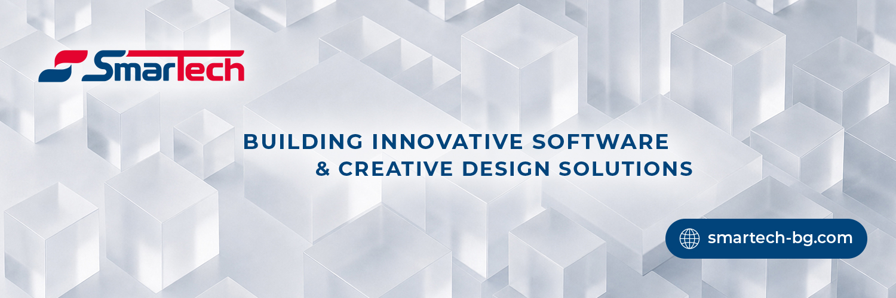

👋

# Hello, I'm Penka Kamenova

### Technology Entrepreneur | CEO at Smartech EOOD

I am passionate about technology, innovation and building digital solutions that create real value for businesses.

As CEO of **[Smartech](https://smartech-bg.com/)**, I focus on developing innovative software products, digital solutions and services that help businesses work smarter and more efficiently.

---

## Areas of Focus

- **Software Products** – Developing practical software solutions for business needs.
- **Digital Transformation** – Improving business processes through technology.
- **Process Automation** – Making complex workflows simpler and more efficient.
- **Artificial Intelligence** – Exploring AI technologies and their practical applications.
- **Creative Technology** – Combining software, design and innovation.

## Current Focus

Building and growing innovative software solutions at Smartech, with a particular interest in business automation, digital transformation and emerging technologies.

## Interests

Artificial Intelligence · Software Innovation · Technology Trends · Digital Business · Creative Design

## Connect With Me

- **Website:** [Smartech](https://smartech-bg.com/)
- **GitHub:** [@pepakam](https://github.com/pepakam)

---

  <i>Building innovative solutions. Connecting technology with ideas.</i>

